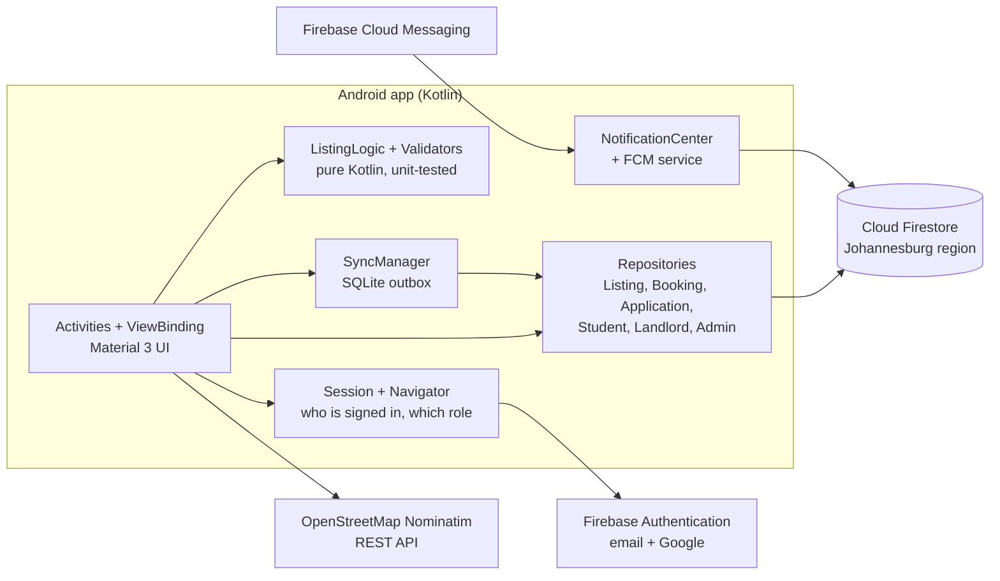

# BenSuet Stay

**BenSuet Stay** is an Android app that connects South African students with safe, verified accommodation near their campus. It matches each student to residences that accept their funding (NSFAS or self-funded/bursary), in any of the country's 11 written official languages. It also keeps working when data runs out.

Built by **Mpilonhle Memela** ([Mansuet Dev](https://mansuetdev.tech)) as the Portfolio of Evidence for **OPSC6312** at Rosebank College (The IIE).

---

## Contents

1. [Purpose of the app](#1-purpose-of-the-app)
2. [Project Structure](#2-project-structure)
3. [Design considerations](#3-design-considerations)
4. [GitHub and GitHub Actions](#4-github-and-github-actions)
5. [Release notes](#5-release-notes)
6. [Getting started](#6-getting-started)
7. [PoE requirements map](#7-poe-requirements-map)
8. [Demo video](#8-demo-video)
9. [Use of AI tools](#9-use-of-ai-tools)

---

## 1. Purpose of the app

**The problem.** Every year thousands of students look for a place to stay near campus, usually through social media posts and word of mouth. Their needs differ:
- **NSFAS students** can only use NSFAS-accredited residences.
- **Self-funded and bursary students** compare prices and distance.
- **Everyone** is exposed to fake listings, unsafe buildings and landlords who never reply.

**The solution.** BenSuet Stay puts verified listings in one place:
- Listings are created by an administrator and assigned to vetted landlords.
- Each student sees what fits their funding type and campus.
- Students can book a viewing, apply for a room and follow every step until a decision.

| Role | What they do in the app |
| --- | --- |
| **Student** | Registers (email or Google). Browses residences filtered by funding and campus, with distance to campus. Books viewings and applies for rooms (NSFAS confirmation or self-funded registration). Tracks applications and landlord feedback, and gets notified of every decision. |
| **Landlord** | Account created by an admin. Sees only their own listings, and confirms or declines viewing requests with a reason. Reviews applications and approves or declines them; room availability updates automatically. |
| **Admin** | Creates and edits listings (rooms, prices, amenities, photos). Creates landlord accounts, sends password resets and removes accounts. Sees platform totals. |

---

## 2. Project Structure

```
app/src/main/java/com/mansuetdev/bensuetstay/
├── BenSuetStayApp.kt, BaseActivity.kt      # App start-up; edge-to-edge insets + role guard for every screen
├── Session.kt                              # Signed-in user + role, Navigator
├── *Repository.kt                          # Firestore access (Listing, Student, Landlord, Admin, Booking, Application)
├── MediaUploader.kt, ProfilePhoto.kt       # Cloud Storage uploads (profile pictures only)
├── ListingLogic.kt, Validators.kt          # Pure logic (filters, prices, SA ID/phone): unit tested
├── Welcome / Login / Register / ForgotPassword
├── Home / ListingDetail / BookViewing / ConfirmNsfas / SelfFundedRegistration
├── StudentBookings / StudentApplications / StudentProfile / EditStudentProfile
├── LandlordDashboard / LandlordBookings / LandlordApplications / ApplicationDetail / LandlordProfile
└── AdminDashboard / AdminListings / AddEditListing / AdminLandlords / AddLandlord
firestore.rules, storage.rules, firebase.json   # Security rules (repo root)
```

---

## 3. Design considerations

### 3.1 Architecture

The app is written in Kotlin. Firebase is the backend, so there is no custom server to host or pay for.



- **Screens talk to repositories, never to Firebase directly.** Each repository owns one Firestore collection: its queries, its field names and how documents become Kotlin objects.
- **Business rules are pure Kotlin.** Filtering, price parsing, distance, SA ID and phone validation sit in `ListingLogic` and `Validators`, with no Android code, so plain JUnit tests cover them on every push.
- **Lifecycle-safe live data.** Lists use Firestore listeners tied to the screen's lifecycle and removed in `onStop`, so nothing leaks or updates a closed screen.
- **One shared screen base.** `BaseActivity` handles Android 15 edge-to-edge insets and sends users through the Welcome screen if Android restarted the app without their session.

### 3.2 Data model

| Collection | Document id | Written by | Read by |
| --- | --- | --- | --- |
| `students` | Auth uid | the student | that student, admins |
| `landlords` | Auth uid | admins (landlord: own photo and password flag) | that landlord, admins |
| `admins` | Auth uid | Firebase console | that admin |
| `accommodations` | auto | admins (assigned landlord: room spaces only) | everyone, including guests |
| `bookings` | auto | student creates, landlord responds | that student, that landlord, admins |
| `applications` | auto | student creates, landlord decides | that student, that landlord, admins |
| `notifications` | auto | whoever performed the action | the recipient only |

Records are linked by **ids** (`studentId`, `listingId`, `landlordId`), never by names. Renaming a student or a residence therefore can't break a booking.

### 3.3 Security and privacy

- **One sign-in system for all three roles.** Students, landlords and admins all use Firebase Authentication. Firebase stores passwords as salted scrypt hashes; the app and the database never see them. A user's role is decided by which collection holds their uid.
- **Rules enforce access, not just the app.** `firestore.rules` lets a student read only their own records, a landlord only their own listings' bookings and applications, and only admins change listings. Every query is scoped the same way, so a phone downloads only its user's data.
- **No double-booking.** Approving an application takes a space off the room inside a Firestore **transaction**. Each booking or application is written in the same **batch** as its notification, so both are saved or neither is.
- **POPIA.** The app collects the minimum data, shows an in-app privacy policy, and offers *Delete my account* (re-confirming identity first). SA ID numbers are checked for a valid birth date and Luhn checksum before saving.

### 3.4 Funding-aware matching

- A residence with NSFAS and self-funded rooms appears as **two cards**, each showing only its own rooms and prices.
- The homepage combines three independent filters: **funding type**, **near my campus** and **search**. Signed-in students start with their own funding type and campus, and can change these defaults in Settings.
- Rent is stored as a number, so "From R2 500/mo" really is the cheapest room.

### 3.5 Eleven languages

- Every on-screen word (457 strings) lives in `res/values-<code>/strings.xml`: `af`, `zu`, `xh`, `b+nso` (Sepedi has no two-letter code), `tn`, `st`, `ts`, `ss`, `ve`, `nr`, with English as the default.
- The switcher uses AppCompat's per-app language API, so the choice is remembered. On Android 13+ it also appears in the phone's own app settings.
- **Stored data stays language-neutral.** Room types, amenities and funding are saved in English and translated only on screen, so filters and approvals work the same in every language.

### 3.6 Offline-first actions

Students often run out of data, so booking a viewing and applying for a room work offline via a SQLite outbox and Android network callbacks. Listings already opened stay visible offline through Firestore's on-device cache.

### 3.7 Real-time notifications

- **Event alerts.** Each action writes a small `notifications` document. Signed-in users listen for their unread alerts and get a system notification instantly.
- **Push announcements.** Users are subscribed to FCM topics (`all`, `students`, `landlords`, `admins`) for broadcast messages.

### 3.8 REST API: distance to campus

The app calls the **OpenStreetMap Nominatim** geocoding API to turn listing and campus addresses into coordinates. Haversine formula provides straight-line distance.

### 3.10 Constraints and trade-offs

| Constraint | Decision |
| --- | --- |
| Firebase **Spark (free) plan**: no Cloud Storage | Listing photos are linked from the admin's device. Application documents are recorded by file name. |
| Spark plan: no Cloud Functions | Event alerts are delivered in real time while the app is running. |
| Nominatim is a shared free service | Results are cached and requests limited to one per second. |

### 3.11 Testing

- **Unit tests:** `ListingLogicTest` and `ValidatorsTest` cover filtering, campus matching, price parsing, and SA ID/phone validation.
- **Tests command:** `./gradlew testDebugUnitTest`

---

## 4. GitHub and GitHub Actions

- **Repository:** [BENEDICT-COD/BenSuetStay](https://github.com/BENEDICT-COD/BenSuetStay)
- **CI/CD:** `android-ci.yml` runs tests and builds the debug APK on every push. `release.yml` builds a signed release APK when a version tag (e.g. `v2.0.0`) is pushed.

---

## 5. Release notes

The full list of updates since the prototype is in **[RELEASE_NOTES.md](RELEASE_NOTES.md)**. Technical history is in [CHANGELOG.md](CHANGELOG.md).

---

## 6. Getting started

1. Clone the repo and open it in Android Studio.
2. In **Firebase → Authentication**, enable **Email/Password** and **Google**.
3. Add your SHA-1 to Firebase and download the new `google-services.json`.
4. Publish `firestore.rules` to your project.
5. **Create the first admin:** Add a user in Auth, then create a document in `admins/<UID>` with `name` and `email`.

### Upgrading from an earlier build
- Delete old `landlords` and `admins` documents from Firestore.
- Recreate the admin and landlords through the app.
- Reassign existing listings to their new landlord IDs.

---

## 7. PoE requirements map

| Requirement | Where it's met |
| --- | --- |
| Register and log in, encrypted password | Firebase Authentication: `LoginActivity`, `RegisterActivity` |
| Single sign-on | Continue with Google: `GoogleSignIn.kt` |
| User settings | `StudentProfileActivity`, `LandlordProfileActivity` |
| REST API | OpenStreetMap Nominatim: `GeocodingApi.kt` |
| Offline mode with sync (SQLite) | `OfflineStore.kt`, `SyncManager.kt` |
| Real-time notifications | `NotificationCenter.kt`, `BenSuetMessagingService.kt` |
| At least two SA languages | All 11 SA languages: `res/values-*` |
| NoSQL store and read | Cloud Firestore: `*Repository.kt` |

---

## 8. Demo video
The video shows:
1. Register and log in.
2. Google sign-in.
3. Settings & Language switch.
4. Distance to campus.
5. Offline booking and sync.
6. Real-time notifications.
7. Landlord and admin flows.

---

<p align="center"><sub>© 2026 Mpilonhle Memela · Mansuet Dev · Built for the OPSC6312 Portfolio of Evidence, Rosebank College (The IIE)</sub></p>
