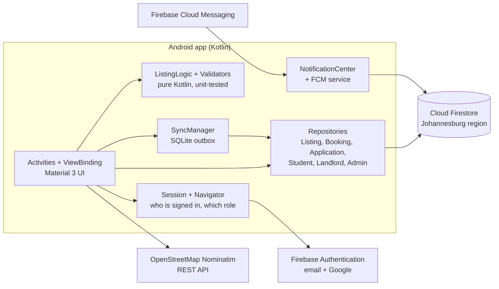
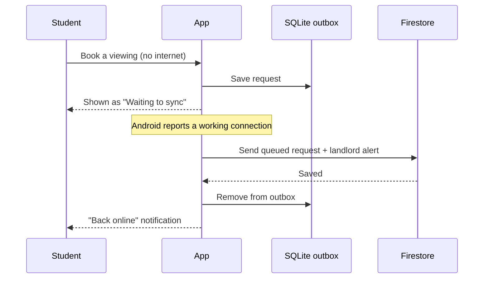
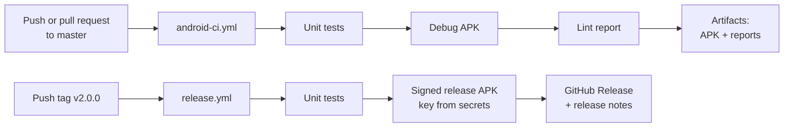

**BenSuet Stay** is an Android app that connects South African students with safe, verified accommodation near their campus. It matches each student to residences that accept their funding (NSFAS or self-funded/bursary), in any of the country's 11 written official languages. It also keeps working when data runs out.

Built by **Mpilonhle Memela** ([Mansuet Dev](https://mansuetdev.tech)) as the Portfolio of Evidence for OPSC6312 at Rosebank College (The IIE).

## Contents

1. [Purpose of the app](#1-purpose-of-the-app)
2. [Screenshots](#2-screenshots)
3. [Design considerations](#3-design-considerations)
4. [GitHub and GitHub Actions](#4-github-and-github-actions)
5. [Release notes](#5-release-notes)
6. [Getting started](#6-getting-started)
7. [PoE requirements map](#7-poe-requirements-map)
8. [Demo video](#8-demo-video)
9. [Use of AI tools](#9-use-of-ai-tools)

---

## 1. Purpose of the app

**The problem.** Every year thousands of students look for a place to stay near campus, usually through social media posts and word of mouth. Their needs differ:
- **NSFAS students** can only use NSFAS-accredited residences.
- **Self-funded and bursary students** compare prices and distance.
- **Everyone** is exposed to fake listings, unsafe buildings and landlords who never reply.

**The solution.** BenSuet Stay puts verified listings in one place:
- Listings are created by an administrator and assigned to vetted landlords.
- Each student sees what fits their funding type and campus.
- Students can book a viewing, apply for a room and follow every step until a decision.

| Role | What they do in the app |
| --- | --- |
| **Student** | Registers (email or Google). Browses residences filtered by funding and campus, with distance to campus. Books viewings and applies for rooms (NSFAS confirmation or self-funded registration). Tracks applications and landlord feedback, and gets notified of every decision. |
| **Landlord** | Account created by an admin. Sees only their own listings, and confirms or declines viewing requests with a reason. Reviews applications and approves or declines them; room availability updates automatically. |
| **Admin** | Creates and edits listings (rooms, prices, amenities, photos). Creates landlord accounts, sends password resets and removes accounts. Sees platform totals. |

---


## 3. Design considerations

### 3.1 Architecture

The app is written in Kotlin. Firebase is the backend, so there is no custom server to host or pay for.



- **Screens talk to repositories, never to Firebase directly.** Each repository owns one Firestore collection: its queries, its field names and how documents become Kotlin objects.
- **Business rules are pure Kotlin.** Filtering, price parsing, distance, SA ID and phone validation sit in `ListingLogic` and `Validators`, with no Android code, so plain JUnit tests cover them on every push.
- **Lifecycle-safe live data.** Lists use Firestore listeners tied to the screen's lifecycle and removed in `onStop`, so nothing leaks or updates a closed screen.
- **One shared screen base.** `BaseActivity` handles Android 15 edge-to-edge insets and sends users through the Welcome screen if Android restarted the app without their session.

### 3.2 Data model

| Collection | Document id | Written by | Read by |
| --- | --- | --- | --- |
| `students` | Auth uid | the student | that student, admins |
| `landlords` | Auth uid | admins (landlord: own photo and password flag) | that landlord, admins |
| `admins` | Auth uid | Firebase console | that admin |
| `accommodations` | auto | admins (assigned landlord: room spaces only) | everyone, including guests |
| `bookings` | auto | student creates, landlord responds | that student, that landlord, admins |
| `applications` | auto | student creates, landlord decides | that student, that landlord, admins |
| `notifications` | auto | whoever performed the action | the recipient only |

Records are linked by **ids** (`studentId`, `listingId`, `landlordId`), never by names. Renaming a student or a residence therefore can't break a booking.

### 3.3 Security and privacy

- **One sign-in system for all three roles.** Students, landlords and admins all use Firebase Authentication. Firebase stores passwords as salted scrypt hashes; the app and the database never see them. A user's role is decided by which collection holds their uid.
- **Rules enforce access, not just the app.** [`firestore.rules`](firestore.rules) lets a student read only their own records, a landlord only their own listings' bookings and applications, and only admins change listings. Every query is scoped the same way, so a phone downloads only its user's data.
- **No double-booking.** Approving an application takes a space off the room inside a Firestore **transaction**. Each booking or application is written in the same **batch** as its notification, so both are saved or neither is.
- **POPIA.** The app collects the minimum data, shows an in-app privacy policy, and offers *Delete my account* (re-confirming identity first). SA ID numbers are checked for a valid birth date and Luhn checksum before saving.

### 3.4 Funding-aware matching

- A residence with NSFAS and self-funded rooms appears as **two cards**, each showing only its own rooms and prices.
- The homepage combines three independent filters: **funding type**, **near my campus** and **search**. Signed-in students start with their own funding type and campus, and can change these defaults in Settings.
- Rent is stored as a number, so "From R2 500/mo" really is the cheapest room.

### 3.5 Eleven languages

- Every on-screen word (457 strings) lives in `res/values-<code>/strings.xml`: `af`, `zu`, `xh`, `b+nso` (Sepedi has no two-letter code), `tn`, `st`, `ts`, `ss`, `ve`, `nr`, with English as the default.
- The switcher uses AppCompat's per-app language API, so the choice is remembered. On Android 13+ it also appears in the phone's own app settings.
- **Stored data stays language-neutral.** Room types, amenities and funding are saved in English and translated only on screen, so filters and approvals work the same in every language.
- **Notifications are stored as a type plus values, not text.** Each person reads them in their own language.

### 3.6 Offline-first actions

Students often run out of data, so booking a viewing and applying for a room work offline:



Applications are re-checked for duplicates on the server before sending. Listings already opened stay visible offline through Firestore's on-device cache.

### 3.7 Real-time notifications

- **Event alerts.** Each action writes a small `notifications` document. Signed-in users listen for their unread alerts and get a system notification instantly: new viewing request or application, viewing confirmed or declined, application decided.
- **Push announcements.** Users are subscribed to Firebase Cloud Messaging topics (`all`, `students`, `landlords`, `admins`), so messages sent from the Firebase console arrive even when the app is closed.
- **User control.** Both can be switched off in **Settings → Notifications**.

### 3.8 REST API: distance to campus

The app calls the **OpenStreetMap Nominatim** geocoding API (`GET /search?q=…&format=json&countrycodes=za`) to turn listing and campus addresses into coordinates. The haversine formula then gives the straight-line distance. Following Nominatim's usage policy, requests:
- identify the app with a User-Agent;
- run at most once per second;
- are cached on the device;
- are credited in **Settings → About**.

### 3.9 UI, UX and accessibility

- **Look and layout.** Material 3 in the brand blue `#123DAD`, with layouts that work edge-to-edge on Android 15+.
- **Clear feedback.** Every list has an empty-state message, and errors are written in plain language (e.g. "No internet connection") instead of exception text.
- **Accessibility.** New controls have 48 dp touch targets and content descriptions.
- **Settings that do real work:** notification switches, homepage defaults, offline sync status with *send now*, change password, FAQ, contact support, privacy policy and account deletion.

### 3.10 Constraints and trade-offs

| Constraint | Decision |
| --- | --- |
| Firebase **Spark (free) plan**: no Cloud Storage | Listing photos are linked from the admin's device. Application documents are recorded by file name, and students bring originals to the viewing. |
| Spark plan: no Cloud Functions | Event alerts are delivered in real time while the app is running. Console pushes cover the app being closed. |
| Nominatim is a shared free service | Results are cached and requests limited to one per second. |
| Machine-assisted translations | All translations pass automated checks (every string present, placeholders and line breaks intact). A native-speaker review is recommended before release. |

### 3.11 Testing

- **Unit tests:** `ListingLogicTest` and `ValidatorsTest` (14 tests) cover filtering, campus matching, price parsing, distance, and the SA ID, phone and email checks. They run on every push in GitHub Actions.
- **Manual end-to-end test per release:**
  1. As admin, create a landlord and a listing.
  2. As a student, book a viewing and apply.
  3. As the landlord, confirm and approve.
  4. As the student, see the result.
  5. Repeat the booking in airplane mode to test offline sync.

---

## 4. GitHub and GitHub Actions

### 4.1 How GitHub is used

- **One repository** ([BENEDICT-COD/BenSuetStay](https://github.com/BENEDICT-COD/BenSuetStay)) holds the code, the security rules, this README and the release notes.
- **Branches:** `master` always builds. Each feature is developed on its own branch (e.g. `feature/offline-sync`) and merged through a **pull request**, which must pass CI first.
- **Commits** are small and describe the change, e.g. `Add SQLite outbox for offline bookings`.
- **Releases** are tagged `vMAJOR.MINOR.PATCH` (e.g. `v2.0.0`). Each tag gets a GitHub Release with the signed APK and the notes from `RELEASE_NOTES.md`.
- **What's not committed:** build output, `local.properties` and signing keys (`*.jks`) are excluded by `.gitignore`. `google-services.json` *is* committed on purpose: Android Firebase keys aren't secret, and access is protected by `firestore.rules`.

### 4.2 GitHub Actions workflows



| Workflow | Runs when | What it does | Output |
| --- | --- | --- | --- |
| [`android-ci.yml`](.github/workflows/android-ci.yml) | Every push and pull request to `master`/`main`, or manually | Sets up JDK 17 and cached Gradle, runs the unit tests, builds the debug APK, runs Android Lint | Downloadable debug APK, test and lint reports, the status badge at the top of this page |
| [`release.yml`](.github/workflows/release.yml) | Pushing a tag that starts with `v` | Runs the tests, restores the signing key from encrypted secrets, builds the signed release APK, publishes a GitHub Release | `BenSuetStay-v2.0.0.apk` attached to the release, with these release notes |

The signing key never enters the repository. The release workflow decodes it from a secret into a temporary file, and Gradle reads the passwords from environment variables (see `signingConfigs` in `app/build.gradle.kts`).

### 4.3 Setting up a signed release

1. Encode your release keystore (PowerShell):
   ```powershell
   [Convert]::ToBase64String([IO.File]::ReadAllBytes("C:\Users\<you>\Documents\Keys\bensuetstay-release.jks")) | Set-Clipboard
   ```
2. Add four secrets under GitHub → **Settings → Secrets and variables → Actions → New repository secret**:
   - `SIGNING_KEYSTORE_BASE64` (paste the encoded key)
   - `SIGNING_STORE_PASSWORD`
   - `SIGNING_KEY_ALIAS` (`bensuetstay`)
   - `SIGNING_KEY_PASSWORD`
3. Tag and push:
   ```bash
   git tag v2.0.0
   git push origin v2.0.0
   ```
4. Open the **Actions** tab to watch it run. The signed APK then appears under **Releases**.

<p align="center"><br><sub>Successful workflow runs in the Actions tab</sub></p>

---

## 5. Release notes

The full list of updates since the prototype, with the innovative features in each version, is in **[RELEASE_NOTES.md](RELEASE_NOTES.md)**. The technical change log is in [CHANGELOG.md](CHANGELOG.md).

| Version | Date | Highlights |
| --- | --- | --- |
| **2.0.0** | November 2026 | 11 South African languages · Google sign-in · offline mode with sync · real-time notifications · distance to campus (REST API) · full Settings · secure role-based access · funding-aware applications |
| 1.0.0 | September 2026 | First working app: student, landlord and admin flows on Firebase |
| Prototype | Part 1 | Design prototype of the screens and user flows |

---

## 6. Getting started

**Requirements:** Android Studio (latest stable), JDK 17+, a Firebase project (the free **Spark** plan is enough), and a phone or emulator running Android 8.0+.

1. Clone the repo and open it in Android Studio. The included `app/google-services.json` connects it to the BenSuet Stay Firebase project; for your own project, replace it with yours.
2. In **Firebase → Authentication → Sign-in method**, enable **Email/Password** and **Google**.
3. **Google sign-in setup:**
   1. Add your SHA-1 fingerprint (Android Studio: *Gradle → app → Tasks → android → signingReport*) under **Project settings → Your apps → Add fingerprint**.
   2. Download `google-services.json` again into `app/`.
4. Paste [`firestore.rules`](firestore.rules) into **Firestore → Rules** and click **Publish**. Republish whenever the file changes.
5. **Create the first admin:**
   1. **Authentication → Users → Add user.**
   2. Copy the user's UID.
   3. In **Firestore**, create the document `admins/<UID>` with the fields `name` and `email`.
6. Run the app. Log in as the admin, create a landlord and a listing, and assign the listing to that landlord.
7. *(Optional)* Test push notifications: **Firebase → Messaging → New campaign → Notification**, with the topic `students`.

Run the tests locally with `./gradlew testDebugUnitTest`.

---

## 7. PoE requirements map

| Requirement | Where it's met |
| --- | --- |
| Register and log in, encrypted password | Firebase Authentication (scrypt hashing): `LoginActivity`, `RegisterActivity` |
| Single sign-on | Continue with Google: `GoogleSignIn.kt` |
| User settings | `SettingsSections.kt`, `StudentProfileActivity`, `LandlordProfileActivity` |
| REST API | OpenStreetMap Nominatim: `GeocodingApi.kt` |
| Offline mode with sync (SQLite) | `OfflineStore.kt`, `SyncManager.kt` |
| Real-time notifications | `NotificationCenter.kt`, `BenSuetMessagingService.kt`, `Notifier.kt` |
| At least two SA languages | All 11: `res/values-*`, `LanguagePicker.kt` |
| NoSQL store and read | Cloud Firestore: `*Repository.kt` |
| GitHub + GitHub Actions | `.github/workflows/`, section 4 |
| App icon and image assets | Adaptive launcher icon, `docs/images/` |

---

## 8. Demo video
The video shows, in order:
1. Register and log in.
2. Google sign-in.
3. Settings.
4. Language switch.
5. Distance to campus.
6. Offline booking and sync.
7. Real-time notifications between a student and a landlord.
8. Push notification from the console.
9. The landlord and admin flows.

---


---

<p align="center"><sub>© 2026 Mpilonhle Memela · Mansuet Dev · Built for the OPSC6312 Portfolio of Evidence, Rosebank College (The IIE)</sub></p>
